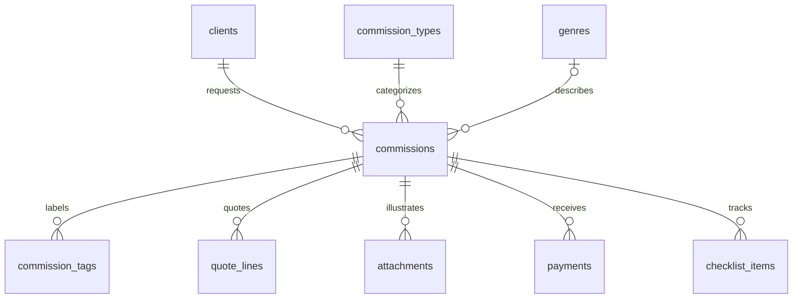

# OBRA database guide — SQLite backend handoff

Updated November 10, 2026. Read alongside [layout.md](layout.md) for screens and button behavior, [reconnect-algo.md](reconnect-algo.md) for recommendations, and the [general data plan](docs/data-plan.md) for a shorter overview.

This is a proposed version-one database design for the backend teammates working in Android Studio. It includes executable schema SQL, field meanings, reads/writes, and validation examples. It does not create an Android application or change the session-only clickable wireframe into a persistent app.

## 1. Requirements and proposed defaults

**Owner requirements:** keep clients, commissions, references, payments, dates, simple checklists, and financial summaries; use local SQLite; keep Reconnect separate and match by commission type and genre. Work progress and payment progress are independent. There are no task-specific deadlines, image-processing recommendations, automatic messages, or actual payment transfers.

The following are **implementation proposals**, rather than newly approved product decisions:

| Question | Baseline used in this guide |
| --- | --- |
| Artist accounts | One local artist workspace; no login/user table in v1 |
| Currency | PHP only; store integer centavos, e.g. PHP 1,500.00 = `150000` |
| Client identity | One exact platform/username pair per client record; multi-platform linking is deferred |
| Genre | One optional primary genre per commission; other style labels stay separate |
| Completed | Artist confirms work is finished and supplies an actual finish date; delivery/acceptance rules remain open |
| Receipts | Append-only received payments; no receipt editing, refunds, or deletion flow until those policies are designed |
| Cancellation | Preserve the commission and its receipts; exclude cancelled work from actionable outstanding balances |
| Images | Store attachment locations/metadata in SQLite; keep image files outside the database |
| Recommendations | Calculate on demand from history; no saved recommendation table |

These choices make the schema concrete and reviewable. If teammates choose multiple genres, linked contacts, refunds, or a different completion meaning, revise the schema and [open decisions](docs/decisions.md) before implementation. Do not silently add those features to the wireframes.

## 2. Tables and relationships

| Table | What it stores | Used by |
| --- | --- | --- |
| `clients` | X/Discord contact identity, optional display name and notes | Intake, Details, Reconnect |
| `commission_types` | Full body, Half body, Chibi, Portrait, and optional default package prices | Intake, Insights, Reconnect |
| `genres` | Controlled genre labels, e.g. Fantasy | Intake and Reconnect |
| `commissions` | One artwork request, agreed total, brief, lifecycle, stage, and dates | All major sections |
| `commission_tags` | Extra style labels such as Soft light, excluded from matching | Artwork brief and Details |
| `quote_lines` | Snapshots of the quoted package and chosen add-ons | Price/review steps and editing |
| `attachments` | Reference/final-artwork image locations and ordering | Intake, Details, image viewer |
| `payments` | Individual receipts with amount, date, method, purpose, and note | Payment history, main History, earnings |
| `checklist_items` | Simple task label, order, and done/unfinished state | Home, Details, All tasks |



**Do not create separate Current Queue, Previous Commissions, History, Dashboard, or Insights tables.** They are filtered/aggregated views of these records. Completing an artwork changes its status; it does not move or copy the record to another table.

## 3. Storage conventions and field meanings

Use internal integer keys to link records. Screen titles and usernames are display values, not navigation keys. A title change must not break payment/image/recommendation links.

- **Money:** `*_minor` means integer centavos. Use Kotlin `Long`, parse decimal input exactly, allow at most two fractional digits, and reject overflow. Do not calculate money through `Float`/`Double`. Set a reasonable application input maximum so aggregate totals fit a signed 64-bit integer.
- **Business dates:** store local calendar dates as fixed-width `YYYY-MM-DD` text, e.g. `2026-11-10`. Parse calendar validity in the application. SQL format checks below cannot reject every impossible date such as February 30.
- **Metadata timestamps:** `created_at`/`updated_at` are UTC timestamp strings. They are not the business dates used for monthly earnings. On updates, the repository must explicitly update `updated_at`.
- **Booleans:** store `0` or `1`. SQLite supports these representations and several date storage approaches; the specific conventions above are this project's choices. [SQLite data types](https://www.sqlite.org/datatype3.html)
- **Missing optional values:** use `NULL`, not the literal strings `"null"` or `"N/A"`. Trim text and turn blank optional input into `NULL`.
- **Submission tokens:** generate a UUID once per Add commission/payment draft. Reuse it on a retry to prevent duplicate writes after repeated taps or uncertain Save results. Do not generate a fresh token for each retry.

### Commission fields

`client_id`, `type_id`, and optional `primary_genre_id` connect to the lookup records. `client_display_name` is the optional name captured for this request; editing it need not rename other requests. `title`, `brief`, `pose_notes`, and `notes` describe the artwork. Reference files are separate attachment rows.

`agreed_total_minor` is the accepted price. `quote_lines` retain the offered package/add-on descriptions and amounts at that time. Their sum is a suggested quote, not an extra payment or a forced replacement for an agreed-price override. Changing a package's default price must never reprice an existing commission.

| Date | Meaning |
| --- | --- |
| `commission_on` | Date the request was accepted/recorded as a commission |
| `planned_start_on` | Optional intended start, separate from the actual start |
| `started_on` | Actual start recorded by Start commission |
| `due_on` | Overall artwork deadline; can be before the eventual finish date |
| `finished_on` | Actual finish confirmed during completion; not a payment date |
| `cancelled_on` | Cancellation date, if a future cancellation flow is approved |

Proposed date validation: due date is on/after commission date; planned start lies between them; actual start is on/after commission date; actual finish is on/after actual start. A late actual start/finish is allowed beyond the original deadline. Actual received/start/finish/cancellation dates cannot be in the future relative to the device's local date. A historical edit cannot move `commission_on` after an existing receipt. These detailed rules need frontend/backend agreement; visual samples alone do not settle them.

### Independent states

| Lifecycle | Creative stage | Actual dates |
| --- | --- | --- |
| `QUEUED` | `NULL` | No actual start/finish |
| `IN_PROGRESS` | `SKETCH`, `LINEART`, or `COLORS` | Actual start present; no finish |
| `COMPLETED` | `FINISHED` | Actual start and finish present |
| `CANCELLED` | May retain the previous stage | Cancellation present; no finish under this baseline |

Payment status is calculated from receipts: zero = Unpaid; positive below agreed total = Partially paid; equal to agreed total = Fully paid. There is no stored `paid` flag. A completed commission may be unpaid; a queued/current commission may be fully paid. Completing work never inserts a receipt or checks off unfinished tasks automatically.

## 4. Proposed v1 schema SQL

This block can be executed in a fresh SQLite database for review. On Android, enable foreign keys in `SQLiteOpenHelper.onConfigure()` and execute each schema statement individually in `onCreate()`. Do not split this text on every semicolon: trigger bodies contain their own statements. The SQL avoids newer features such as STRICT tables and window functions so the project can choose its Android API range later.

Foreign-key enforcement must be enabled for each connection; declaring a relationship alone is insufficient. [SQLite foreign keys](https://www.sqlite.org/foreignkeys.html)

```sql
-- BEGIN V1 SCHEMA
PRAGMA foreign_keys = ON;

CREATE TABLE clients (
    id INTEGER PRIMARY KEY,
    platform TEXT NOT NULL CHECK (platform IN ('X', 'DISCORD')),
    username TEXT NOT NULL CHECK (length(trim(username)) > 0),
    display_name TEXT,
    notes TEXT,
    UNIQUE (platform, username)
);

CREATE TABLE commission_types (
    id INTEGER PRIMARY KEY,
    name TEXT NOT NULL UNIQUE CHECK (length(trim(name)) > 0),
    default_price_minor INTEGER CHECK (
        default_price_minor IS NULL OR
        (typeof(default_price_minor) = 'integer' AND default_price_minor >= 0)
    ),
    is_active INTEGER NOT NULL DEFAULT 1 CHECK (is_active IN (0, 1))
);

CREATE TABLE genres (
    id INTEGER PRIMARY KEY,
    name TEXT NOT NULL UNIQUE CHECK (length(trim(name)) > 0),
    is_active INTEGER NOT NULL DEFAULT 1 CHECK (is_active IN (0, 1))
);

CREATE TABLE commissions (
    id INTEGER PRIMARY KEY,
    creation_token TEXT NOT NULL UNIQUE CHECK (length(trim(creation_token)) > 0),
    client_id INTEGER NOT NULL REFERENCES clients(id) ON DELETE RESTRICT,
    type_id INTEGER NOT NULL REFERENCES commission_types(id) ON DELETE RESTRICT,
    primary_genre_id INTEGER REFERENCES genres(id) ON DELETE RESTRICT,
    client_display_name TEXT,
    title TEXT NOT NULL CHECK (length(trim(title)) > 0),
    brief TEXT,
    pose_notes TEXT,
    notes TEXT,
    agreed_total_minor INTEGER NOT NULL CHECK (
        typeof(agreed_total_minor) = 'integer' AND agreed_total_minor > 0
    ),
    status TEXT NOT NULL DEFAULT 'QUEUED'
        CHECK (status IN ('QUEUED', 'IN_PROGRESS', 'COMPLETED', 'CANCELLED')),
    stage TEXT CHECK (stage IN ('SKETCH', 'LINEART', 'COLORS', 'FINISHED')),
    commission_on TEXT NOT NULL CHECK (
        commission_on GLOB '[0-9][0-9][0-9][0-9]-[0-9][0-9]-[0-9][0-9]'
    ),
    planned_start_on TEXT,
    started_on TEXT,
    due_on TEXT NOT NULL CHECK (
        due_on GLOB '[0-9][0-9][0-9][0-9]-[0-9][0-9]-[0-9][0-9]'
        AND due_on >= commission_on
    ),
    finished_on TEXT,
    cancelled_on TEXT,
    cancellation_note TEXT,
    created_at TEXT NOT NULL DEFAULT (strftime('%Y-%m-%dT%H:%M:%fZ', 'now')),
    updated_at TEXT NOT NULL DEFAULT (strftime('%Y-%m-%dT%H:%M:%fZ', 'now')),
    CHECK (planned_start_on IS NULL OR
        (planned_start_on GLOB '[0-9][0-9][0-9][0-9]-[0-9][0-9]-[0-9][0-9]'
         AND planned_start_on BETWEEN commission_on AND due_on)),
    CHECK (started_on IS NULL OR
        (started_on GLOB '[0-9][0-9][0-9][0-9]-[0-9][0-9]-[0-9][0-9]'
         AND started_on >= commission_on)),
    CHECK (finished_on IS NULL OR
        (finished_on GLOB '[0-9][0-9][0-9][0-9]-[0-9][0-9]-[0-9][0-9]'
         AND started_on IS NOT NULL AND finished_on >= started_on)),
    CHECK (cancelled_on IS NULL OR
        (cancelled_on GLOB '[0-9][0-9][0-9][0-9]-[0-9][0-9]-[0-9][0-9]'
         AND cancelled_on >= commission_on
         AND (started_on IS NULL OR cancelled_on >= started_on))),
    CHECK (
        (status = 'QUEUED' AND stage IS NULL AND started_on IS NULL AND finished_on IS NULL)
        OR (status = 'IN_PROGRESS' AND stage IS NOT NULL
            AND stage IN ('SKETCH', 'LINEART', 'COLORS')
            AND started_on IS NOT NULL AND finished_on IS NULL)
        OR (status = 'COMPLETED' AND stage IS NOT NULL AND stage = 'FINISHED'
            AND started_on IS NOT NULL AND finished_on IS NOT NULL)
        OR (status = 'CANCELLED' AND finished_on IS NULL)
    ),
    CHECK ((status = 'CANCELLED' AND cancelled_on IS NOT NULL)
        OR (status <> 'CANCELLED' AND cancelled_on IS NULL))
);

CREATE TABLE commission_tags (
    commission_id INTEGER NOT NULL REFERENCES commissions(id) ON DELETE RESTRICT,
    label TEXT NOT NULL CHECK (length(trim(label)) > 0),
    PRIMARY KEY (commission_id, label)
);

CREATE TABLE quote_lines (
    id INTEGER PRIMARY KEY,
    commission_id INTEGER NOT NULL REFERENCES commissions(id) ON DELETE RESTRICT,
    kind TEXT NOT NULL CHECK (kind IN ('BASE', 'ADDON')),
    label TEXT NOT NULL CHECK (length(trim(label)) > 0),
    amount_minor INTEGER NOT NULL CHECK (
        typeof(amount_minor) = 'integer' AND amount_minor >= 0
    ),
    sort_order INTEGER NOT NULL DEFAULT 0 CHECK (sort_order >= 0)
);

CREATE TABLE attachments (
    id INTEGER PRIMARY KEY,
    commission_id INTEGER NOT NULL REFERENCES commissions(id) ON DELETE RESTRICT,
    kind TEXT NOT NULL CHECK (kind IN ('REFERENCE', 'FINAL')),
    storage_kind TEXT NOT NULL CHECK (storage_kind IN ('CONTENT_URI', 'APP_FILE')),
    location TEXT NOT NULL CHECK (length(trim(location)) > 0),
    display_name TEXT,
    mime_type TEXT NOT NULL CHECK (mime_type LIKE 'image/%'),
    caption TEXT,
    sort_order INTEGER NOT NULL DEFAULT 0 CHECK (sort_order >= 0)
);

CREATE TABLE payments (
    id INTEGER PRIMARY KEY,
    commission_id INTEGER NOT NULL REFERENCES commissions(id) ON DELETE RESTRICT,
    submission_token TEXT NOT NULL UNIQUE CHECK (length(trim(submission_token)) > 0),
    amount_minor INTEGER NOT NULL CHECK (
        typeof(amount_minor) = 'integer' AND amount_minor > 0
    ),
    received_on TEXT NOT NULL CHECK (
        received_on GLOB '[0-9][0-9][0-9][0-9]-[0-9][0-9]-[0-9][0-9]'
    ),
    method TEXT NOT NULL CHECK (method IN ('GCASH', 'BANK_TRANSFER', 'PAYPAL', 'CASH', 'OTHER')),
    purpose TEXT NOT NULL CHECK (purpose IN ('INITIAL', 'PARTIAL', 'BALANCE')),
    note TEXT,
    created_at TEXT NOT NULL DEFAULT (strftime('%Y-%m-%dT%H:%M:%fZ', 'now'))
);

CREATE TABLE checklist_items (
    id INTEGER PRIMARY KEY,
    commission_id INTEGER NOT NULL REFERENCES commissions(id) ON DELETE RESTRICT,
    label TEXT NOT NULL CHECK (length(trim(label)) > 0),
    is_done INTEGER NOT NULL DEFAULT 0 CHECK (is_done IN (0, 1)),
    sort_order INTEGER NOT NULL DEFAULT 0 CHECK (sort_order >= 0)
);

CREATE INDEX idx_work_due ON commissions(status, due_on, id);
CREATE INDEX idx_work_queue ON commissions(status, planned_start_on, id);
CREATE INDEX idx_work_client ON commissions(client_id);
CREATE INDEX idx_reconnect ON commissions(type_id, primary_genre_id, status, finished_on, id);
CREATE INDEX idx_genre ON commissions(primary_genre_id);
CREATE INDEX idx_payment_month ON payments(received_on, id);
CREATE INDEX idx_payment_work ON payments(commission_id, received_on, id);
CREATE INDEX idx_tasks_work ON checklist_items(commission_id, is_done, sort_order);
CREATE INDEX idx_images_work ON attachments(commission_id, kind, sort_order);
CREATE INDEX idx_quote_work ON quote_lines(commission_id, sort_order);

CREATE TRIGGER payment_insert_guard BEFORE INSERT ON payments
BEGIN
    SELECT CASE WHEN NEW.received_on < (
        SELECT commission_on FROM commissions WHERE id = NEW.commission_id
    ) THEN RAISE(ABORT, 'Payment predates commission') END;
    SELECT CASE WHEN NEW.amount_minor + COALESCE((
        SELECT SUM(amount_minor) FROM payments WHERE commission_id = NEW.commission_id
    ), 0) > (
        SELECT agreed_total_minor FROM commissions WHERE id = NEW.commission_id
    ) THEN RAISE(ABORT, 'Payment exceeds remaining balance') END;
END;

CREATE TRIGGER commission_receipt_guard
BEFORE UPDATE OF agreed_total_minor, commission_on ON commissions
BEGIN
    SELECT CASE WHEN NEW.agreed_total_minor < COALESCE((
        SELECT SUM(amount_minor) FROM payments WHERE commission_id = OLD.id
    ), 0) THEN RAISE(ABORT, 'Price is below received payments') END;
    SELECT CASE WHEN EXISTS (
        SELECT 1 FROM payments
        WHERE commission_id = OLD.id AND received_on < NEW.commission_on
    ) THEN RAISE(ABORT, 'Commission date is after an existing payment') END;
END;

-- Proposed append-only receipt policy; redesign before adding corrections/refunds.
CREATE TRIGGER payment_update_guard BEFORE UPDATE ON payments
BEGIN
    SELECT RAISE(ABORT, 'Receipt corrections need a dedicated workflow');
END;

CREATE TRIGGER payment_delete_guard BEFORE DELETE ON payments
BEGIN
    SELECT RAISE(ABORT, 'Receipt deletion is not supported in v1');
END;

CREATE VIEW commission_financials AS
SELECT c.id AS commission_id, c.agreed_total_minor,
       COALESCE(p.received_minor, 0) AS received_minor,
       c.agreed_total_minor - COALESCE(p.received_minor, 0) AS remaining_minor,
       CASE WHEN COALESCE(p.received_minor, 0) = 0 THEN 'UNPAID'
            WHEN p.received_minor = c.agreed_total_minor THEN 'FULLY_PAID'
            ELSE 'PARTIALLY_PAID' END AS payment_status
FROM commissions c
LEFT JOIN (
    SELECT commission_id, SUM(amount_minor) AS received_minor
    FROM payments GROUP BY commission_id
) p ON p.commission_id = c.id;
-- END V1 SCHEMA
```

Seed the type lookup with the reviewed package names; use stable IDs thereafter. Genre values need team agreement; Fantasy is a fictional example, while Soft light belongs in `commission_tags`. A default package price is optional. Retire lookup values with `is_active = 0` rather than deleting/renaming their historical meaning. Existing records must still resolve retired values. A new category meaning should be a new lookup record.

`UNIQUE(platform, username)` uses exact stored text. Trim input; retain the artist-entered spelling. Do not strip punctuation or merge contacts across X/Discord automatically. Decide platform-specific normalization and multi-contact identity separately. When editing a commission's contact, resolve/create the selected client and change that commission's `client_id`; do not rename every historical commission's contact by accident.

Foreign keys use RESTRICT to prevent accidental destruction of history. There is no physical commission-delete action in this handoff. Reference/tag/quote rows may be explicitly removed during an approved edit; received payments may not. Purpose labels describe receipts, not mandatory deposit percentages. Methods are manually recorded labels, not integrations. An `INITIAL` receipt can cover the full agreed total; ordinary receipts can be labelled PARTIAL/BALANCE from the current balance without another UI field.

## 5. Which screen reads or writes what?

| Wireframe | Reads | Writes only after confirmed action |
| --- | --- | --- |
| WF-01 Home | Received payments for month; current/queued commissions; unfinished checklist rows | Checkbox state; other actions navigate |
| WF-02 Commissions | Same commission table filtered by lifecycle, joined with clients/types/financial view | None for filtering/searching |
| WF-03–06 Add | Client/type/genre choices and an unsaved draft | Final Save inserts client if needed, commission, tags, quote lines, references, checklist defaults, optional initial receipt in one transaction |
| WF-07 Details | One commission plus client, type, genre, tags, quote, attachments, tasks, financial view | Start changes status/stage/start date; checkbox changes one item |
| WF-08 Payment history | Receipts for the selected commission and its financial view | None |
| WF-09 Record payment | Same commission and remaining balance | Save inserts one validated receipt |
| WF-10 Progress | Current stage/status | Save changes stage only; Finished proceeds to review |
| WF-11 Complete | Actual finish date draft and current record | Confirm sets COMPLETED/FINISHED/finished date together; preserves receipts and checklist states |
| WF-12 Main History | Individual receipts joined to their parent commission/client, filtered by received month | None |
| WF-13 Insights | Monthly/all-time receipts, receipt-derived type breakdown, current outstanding balances | None |
| WF-14–17 Edit | Prefilled commission, quote, references, tags, read-only received total | Final Save updates the same commission and editable children in one transaction; preserves lifecycle/stage/checklists/receipts |
| WF-18 Image viewer | One attachment location and related image list | Viewing/zoom/Back write nothing; a draft removal is saved only with its parent form |
| WF-19 Reconnect | Selected IN_PROGRESS work and matching COMPLETED history, client/type/genre metadata | None; opening past work is navigation |
| WF-20 All tasks | Unfinished simple checklist items, grouped by active parent commission | Checkbox changes that item |

There is no table for each screen and no persistence on Next/Review alone. Preserve draft values through Back, image-picker returns, and screen recreation using the chosen Android state approach. Do not save partial intake records just because the user moved to the next step.

## 6. Read queries and totals

The examples use named placeholders for clarity. With Android `rawQuery`, use `?` and ordered `selectionArgs`; never concatenate usernames, notes, dates, or filters into SQL. The platform SQLite guide covers binding, insert/query APIs, and cursor handling. [Android SQLite guide](https://developer.android.com/training/data-storage/sqlite)

### A. Commission list/details

```sql
SELECT c.*, cl.platform, cl.username, t.name AS type_name, g.name AS genre_name,
       f.received_minor, f.remaining_minor, f.payment_status
FROM commissions c
JOIN clients cl ON cl.id = c.client_id
JOIN commission_types t ON t.id = c.type_id
LEFT JOIN genres g ON g.id = c.primary_genre_id
JOIN commission_financials f ON f.commission_id = c.id
WHERE c.status = :status
ORDER BY c.due_on ASC, c.id ASC;
```

Use the same joins with `WHERE c.id = :commission_id` for Details. Queued ordering by planned start is a proposal: sort non-null planned starts first, then date and ID. If manual queue order is chosen, add an explicit order field in a migration. An unpaid/overdue label is derived, not a new lifecycle: for example, active work with `due_on < :today` is overdue.

### B. Main History and one artwork's payment history

```sql
SELECT p.id AS payment_id, p.commission_id, p.amount_minor, p.received_on,
       p.method, p.purpose, p.note,
       c.title, c.due_on, c.finished_on, cl.username, cl.platform
FROM payments p
JOIN commissions c ON c.id = p.commission_id
JOIN clients cl ON cl.id = c.client_id
WHERE p.received_on >= :month_start AND p.received_on < :next_month_start
ORDER BY p.received_on DESC, p.id DESC;
```

For WF-08, replace the month condition with `p.commission_id = :commission_id`. Every row opens its parent commission, not another receipt, report, or a record found by matching a title. Keep cancelled commissions' receipts visible.

### C. Monthly/all-time earnings and six-month trend

```sql
SELECT COALESCE(SUM(amount_minor), 0) AS earned_minor, COUNT(*) AS receipt_count
FROM payments
WHERE received_on >= :month_start AND received_on < :next_month_start;

SELECT COALESCE(SUM(amount_minor), 0) AS all_time_earned_minor FROM payments;

SELECT substr(received_on, 1, 7) AS month, SUM(amount_minor) AS earned_minor
FROM payments
WHERE received_on >= :six_month_start AND received_on < :next_month_start
GROUP BY substr(received_on, 1, 7) ORDER BY month;
```

For November 2026, bind `2026-11-01` and `2026-12-01`. Generate month boundaries using calendar arithmetic, including December/January. Fill missing chart months with zero in the application; an empty database gives zero totals and an empty trend query. Mark a current incomplete month appropriately. Monthly earnings use receipt dates, even when the commission was accepted or finished in another month.

### D. Earnings by type and current outstanding balances

```sql
SELECT t.id, t.name, SUM(p.amount_minor) AS earned_minor
FROM payments p
JOIN commissions c ON c.id = p.commission_id
JOIN commission_types t ON t.id = c.type_id
WHERE p.received_on >= :month_start AND p.received_on < :next_month_start
GROUP BY t.id, t.name ORDER BY earned_minor DESC, t.id;

SELECT c.id, c.title, c.status, f.remaining_minor
FROM commissions c JOIN commission_financials f ON f.commission_id = c.id
WHERE c.status <> 'CANCELLED' AND f.remaining_minor > 0
ORDER BY c.due_on, c.id;
```

Outstanding includes completed-but-unpaid work under this proposal and stays a current/all-time obligation view when a past earnings month is selected. Do not count outstanding money as earnings. Type breakdown uses the commission's current type: editing that classification can reclassify historical receipts, while monthly/all-time received totals remain unchanged. If the team needs immutable historical classification, agree and add receipt-level snapshots first.

### E. Simple tasks and Reconnect

```sql
SELECT i.id, i.commission_id, i.label, c.title
FROM checklist_items i JOIN commissions c ON c.id = i.commission_id
WHERE i.is_done = 0 AND c.status IN ('QUEUED', 'IN_PROGRESS')
ORDER BY c.due_on, c.id, i.sort_order, i.id;
```

Use a limited preview on Home and the complete list on All tasks; count the same predicate. Task completion does not finish a commission. No task-date or Send color preview fields are needed.

Reconnect's matching query, client deduplication, and output contract are in [reconnect-algo.md](reconnect-algo.md). Use the same type/genre keys, not free-text comparisons or image content.

Aggregate payments before joining attachments, tags, or tasks. Joining two receipts and three images into six rows and then summing would inflate earnings. The financial view deliberately aggregates payments separately. Use one read transaction if a screen needs several queries to represent the same snapshot.

## 7. Write workflows and validation

### Add commission — one confirmed Save

1. Validate the complete draft: contact/title/type, real calendar dates, positive agreed total, price precision, image availability, and any initial receipt. Optional genre may be missing; Reconnect then cannot match this work.
2. Resolve an existing client by platform/username, or insert a new client. Keep this within the database transaction so a failed Save does not leave an orphan contact.
3. Insert one QUEUED commission using the draft's stable `creation_token`; insert tags, quote snapshots, prepared reference metadata, and reviewed default checklist items.
4. If initial payment is enabled, insert one positive received receipt within the agreed total. Its date must be between commission date and local today. No fixed percentage is required. If disabled, insert no payment.
5. Commit all database rows together, then open that commission. On failure, roll back and retain the draft/error so the user can retry.

Prepare image copies/permissions before the short database transaction. Database rollback cannot undo filesystem operations. Remove newly staged files if Save fails/discards; after a successful save, retain files still referenced by any attachment. Do not delete an old image before an Edit transaction commits.

### Record payment — one receipt

Inside one write transaction, resolve a previous successful Save by `submission_token` first. If it exists, verify it belongs to the same submission and return that receipt instead of inserting another. Otherwise re-read the current balance, validate amount/date/method, and insert. The insert trigger provides a final protection against overpayment. A retry must not change the saved receipt's values under the same token; report conflicting reuse instead.

After commit, refresh Details, its payment history, Home, main History, and Insights from storage. UI optimistic values must not become a second source of truth. Fully paid means Record payment is unavailable until a valid future price change creates a balance. Receipt corrections/refunds require a separate agreed design; do not bypass the append-only triggers to improvise one.

### Edit and progress

- Edit updates only permitted request/quote/reference fields on the existing commission. Preserve received payments, checklist state, actual progress, and status. Use a write transaction and recheck current data so an old draft cannot overwrite a newer payment or stage update.
- Block reducing agreed price below received money. Allowing a price increase creates an additional outstanding balance without changing prior receipts. A changed package default alone does neither.
- Start commission sets IN_PROGRESS, SKETCH, and actual start together. Updating Lineart/Colors changes the stage. Selecting Finished is not a write until completion review is confirmed.
- Confirm completion sets COMPLETED, FINISHED, and the validated actual finish date together. It does not record a final payment, require a zero balance, or silently complete checklist items. Final artwork remains optional pending a product decision.
- Cancellation is a reserved lifecycle, not a fully designed action. Do not expose a destructive deletion or refund action just because the schema has cancellation fields. The proposed cancellation write would retain receipts and use the cancellation date/note.
- For a retry of Add, look up `creation_token` before proceeding and return the existing commission only when it matches that submission. Use ordinary inserts and handle unique constraints; do not use `INSERT OR REPLACE` on financial/history records.

## 8. Android Studio implementation guide

Use a repository layer between the screens and SQLite. Suggested responsibilities are `CommissionRepository` (intake/edit/progress/checklist), `PaymentRepository` (receipts and balances), `ReportRepository` (read-only summaries), and the recommendation teammate's read-only provider. These are organization suggestions, not required class names or an instruction to build the app now.

For direct SQLite, `SQLiteOpenHelper` manages database creation/version callbacks. Enable foreign keys in `onConfigure`; create tables, indexes, triggers, and the view in `onCreate`; apply ordered non-destructive migrations in `onUpgrade`. Do not use a drop-all-tables/recreate upgrade for this app's financial history. Android also recommends Room as an abstraction over SQLite; choosing that library is a team decision, and this handoff does not require changing the intended stack. [Android SQLite guide](https://developer.android.com/training/data-storage/sqlite), [SQLiteOpenHelper reference](https://developer.android.com/reference/android/database/sqlite/SQLiteOpenHelper)

The following is a **workflow sketch**, not a complete Android class:

```kotlin
// SQLiteOpenHelper callback:
override fun onConfigure(db: SQLiteDatabase) {
    super.onConfigure(db)
    db.setForeignKeyConstraintsEnabled(true)
}

// Repository write pattern; run database work off the main/UI thread.
db.beginTransaction()
try {
    // Validate fresh data and use ContentValues + insertOrThrow/update.
    // Insert the parent and all required children using this same db.
    // Check affected-row counts for updates; translate failures to UI errors.
    db.setTransactionSuccessful()
} finally {
    db.endTransaction()
}
// Return success / navigate only after endTransaction() succeeds.
```

Keep a shared helper using application context, execute reads/writes on the project's background execution mechanism, and close query cursors with Kotlin `use`. Bind money as `Long`. Keep network calls/image copying outside the database transaction. Avoid nested `beginTransaction()` workflows; let one repository operation own each write boundary. Helper creation/upgrade callbacks already have their own lifecycle transaction, so do not wrap the schema in another manual SQL BEGIN there. [SQLiteOpenHelper reference](https://developer.android.com/reference/android/database/sqlite/SQLiteOpenHelper), [SQLite transactions](https://www.sqlite.org/lang_transaction.html)

### Images and permissions

Use the Android photo picker for selecting reference images. Choose and document either persistable access to returned content URIs or copying selected files into app-private storage. If retaining a URI, request the offered persistent read grant and handle permission/open failures; a URI string alone is not a durable copy of the file. Show an unavailable-image state without losing the commission. [Android photo picker](https://developer.android.com/training/data-storage/shared/photo-picker)

The schema supports both choices through `storage_kind` and `location`. Verify the content is a supported image; a filename/MIME label alone is not proof. Avoid image BLOBs/base64 in SQLite. App-private relative file locations must resolve within the app's managed image directory. A database-only backup cannot restore separate image files; backup/export is a later design decision.

### Migrations and diagnostics

Start the implemented database at version 1. Each future version needs a migration preserving clients, commission keys, receipts, and attachments. Test upgrading a populated old fixture, not only fresh installs. Inspect `PRAGMA foreign_key_check` and `PRAGMA integrity_check` in development. Never commit real `.db` files, client records, or private reference artwork.

## 9. Backend acceptance checklist

These are implementation acceptance cases; they are not claims that an Android build already exists.

| Case | Expected result |
| --- | --- |
| Save without initial payment | One queued commission, zero received, full outstanding balance |
| Agreed PHP 2,000; initial PHP 500 | `200000` agreed, `50000` received, `150000` outstanding; earnings increase by PHP 500 |
| Later PHP 1,500 receipt | Two receipts, PHP 2,000 received, zero outstanding; no double-counting |
| Complete before balance is paid | Completed artwork still has its remaining balance |
| Pay all while work is current | Fully paid artwork remains IN_PROGRESS |
| November deposit, December balance | Each month includes only its own received money |
| Two receipts plus three reference images | Totals equal the two receipts, not six joined rows |
| Repeated Save/retry token | Exactly one commission/receipt; conflicting token reuse is reported |
| Bad child reference, negative/fractional-cent amount, overpayment | Reject; retain user input and explain the issue |
| Price below received money or commission date after a receipt | Reject without changing previous records |
| Invalid date, future received/finish date | Application rejects before write; SQL additionally checks basic format/order |
| Failure during initial receipt insertion | Entire Add transaction rolls back, including its newly inserted client/children |
| Receipt edit/delete or deleting a referenced client | Block under this baseline |
| Cancelled commission with prior receipts | Receipts remain in History/earnings; no automatic refund |
| Retired type/genre | Historical records still display and match their stored keys; new forms omit retired choices |
| Missing image access | Artwork/receipt data remains usable; image viewer shows unavailable state |
| Empty database | Zero totals, empty lists, clear empty Reconnect state |

For a small fixture, use a PHP 2,000 artwork with PHP 500 received October 30 and PHP 1,500 received November 10: all-time = PHP 2,000, October = PHP 500, November = PHP 1,500, remaining = zero. A separate PHP 1,000 artwork with no receipts increases outstanding only. All sample contacts and amounts must be fictional.

Before implementing, agree on the proposed defaults in section 1, including genre cardinality, contact identity, cancellation/refunds, completion meaning, currency, and quote rules. Keep frontend labels and validations in [layout.md](layout.md) synchronized with those decisions.
