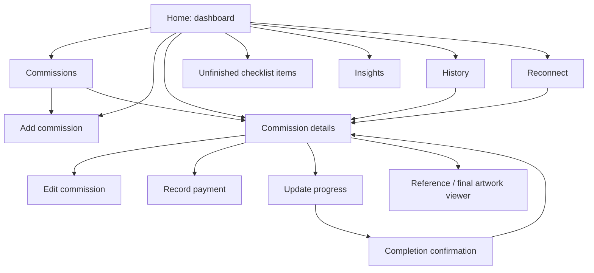

# Screen and navigation plan

The screens below are a planning inventory. The dashboard's visual direction, DynaPuff/Mali pairing, and four-step intake wireframe have been reviewed and accepted as references. New screen drafts and the remaining grouping/navigation decisions still need review. The saved boards and clickable wireframe now form the frontend handoff reference; native Android implementation is still separate.

Use [layout.md](../layout.md) as the master numbered guide. It covers WF-01–WF-20, with labels for filters, saved states, and scroll positions. WF-19 is the separate Reconnect page; WF-20 All tasks is available in the clickable file, with its static board pending. Use [the clickable opening guide](wireframes/CLICKABLE.md).

## Main sections

### Home / Dashboard

Monthly earnings, current work, unfinished tasks, queue preview, and Add commission. See [the dashboard plan](dashboard.md).

### Commissions

A list of artwork records with Current (In progress), Queued, and Completed filters. Search locates a username or project within the selected group. Selecting a commission opens its details. See the [Commissions list draft](commissions-list.md) for these states and the empty list. Cancelled-record access remains a later proposal.

Queued records represent accepted work that has not started. Planned start dates are useful when known, but their required/optional status is still to be decided.

### History

The current recommendation is a chronological view of individual payment transactions across commissions, including deposits and later balance payments. Show the client, related artwork, received amount, received date, and recorded method. Previous artwork itself belongs under Commissions → Completed. A transaction links to the same parent commission and its full dates/details.

One artwork can have multiple payment transactions. Main History should not duplicate the completed-artwork list. The [main History draft](main-history.md), WF-12, now shows month selection, received totals, dated receipt rows, and an empty month. Tapping a payment opens its commission; Back restores the selected month and list position. The commission-specific payment-history page remains WF-08.

### Insights

The [Insights draft](insights.md), WF-13, shows monthly received earnings, an all-time received total, current outstanding balances, a six-month earnings trend, and selected-month earnings by commission type. Two phone views show the overview and lower scroll content of one page. View payments opens WF-12 for the same month; See balances scrolls to the current balances, whose rows open WF-07. Completed-work counts remain a possible later addition.

### Reconnect

The fifth main tab opens [WF-19 Reconnect](reconnect.md), with current-work selection, type/genre context, suggested-client cards, and links to previous completed artwork. It is separate from financial Insights. Recommendations use fixed wireframe fixtures; the designated teammates implement the algorithm/backtracking. No image processing or automatic outreach.

## Main workflow screens

### Add commission

Organize the form into sensible groups:

1. **Client:** username, platform, optional display name.
2. **Request:** package/type, title, brief, pose instructions, genres/tags.
3. **References:** attached images and captions, if needed.
4. **Price and payment:** agreed total, optional add-ons, any payment received.
5. **Schedule:** commission date, planned start if known, and deadline.
6. **Notes:** additional instructions. Custom task entry is deferred under the simplified checklist direction.

The accepted intake wireframe direction in [layout.md](../layout.md) divides entry into four steps: Client details, Artwork brief, Price and dates, and Review commission. It specifies the proposed checks and destinations for Next/Back actions. Detailed validation and price rules remain open; demo transitions are available in the clickable file.

The [Add commission wireframe plan](add-commission.md) describes the current four-screen draft, including reference thumbnails, optional initial-payment entry, the Review screen, and Back/Close behavior. The form omits main bottom navigation and uses the accepted DynaPuff/Mali typography pairing.

### Commission details

Show the complete client/request information, references, agreed price, payment timeline, outstanding balance, dates, lifecycle status, creative stage, and tasks. Previous records can also show the final artwork and actual finish date.

Proposed actions include Edit, Update progress, Record payment, and Cancel. Checklists use simple checkboxes. Completion is reached through Update progress → Finished → Review completion.

See [Commission Details](commission-details.md) for the current static draft: first/lower views of an in-progress record, the queued intake example, and a completed record with an outstanding balance. Record payment and work-progress controls stay separate.

### Edit commission

The [Edit commission draft](edit-commission.md), WF-14–WF-17, reuses the intake structure with existing values and a before/after review. Save changes updates the same artwork and returns to WF-07. Previously received payments are read-only in this form, with no initial-payment toggle. Work status/stage and checklist states are retained. A total below received money is proposed to be blocked; refund/correction and historical pricing/date restrictions still need review.

## Supporting screens or sheets

| View | Purpose |
| --- | --- |
| [Record payment](record-payment.md) | Enter amount, received date, method, and optional note; preview remaining balance; Save opens updated commission payment history |
| [Commission payment history](payment-history.md) | Show a commission's initial and later payments, amounts, received dates, methods, notes, and balance |
| [Update progress and completion](update-progress.md) | WF-10 stage-selection page; Finished opens WF-11 full-page review with actual finished date and unchanged payment totals |
| All tasks, WF-20 | Clickable grouped unfinished checklist, commission links, completion/Undo, and empty state; no task dates/editors |
| Package manager/editor | Maintain offered services, prices, and turnaround estimates |
| [Image viewer](image-viewer.md) | WF-18 dedicated preview page for reference/final images, zoom/pan, collection selection, and Back preserving the originating form/record |
| Date picker | Choose a commission, start, due, or payment date |
| Confirmation dialog | Review a cancellation, deletion, or unsaved-change decision |

Undrawn views may become full screens, dialogs, or sheets. The progress/completion draft currently uses separate full pages; it remains subject to review.

## Conceptual navigation

This diagram describes the handoff routes. The clickable file demonstrates these relationships; the diagram does not prescribe Android Activities.

## Required states across the screen set

Include empty lists, long usernames, multiple references, a long brief, invalid/missing input, partial payment, completed-but-unpaid work, overdue work, cancelled work, and large histories in planning reviews. Use fictional examples.
