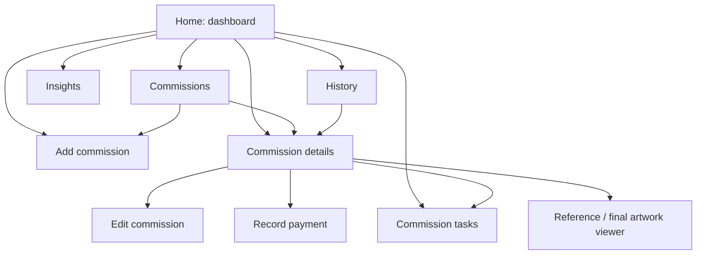

# Screen and navigation plan

The screens below are a planning inventory. Their final names, grouping, and navigation have not been approved. Static wireframes come before executable navigation.

## Main sections

### Home / Dashboard

Monthly earnings, current work, unfinished tasks, queue preview, and Add commission. See [the dashboard plan](dashboard.md).

### Commissions

A list of commission records grouped or filtered by Queued, In progress, Completed, and Cancelled. Proposed search can locate a username or project. Selecting a commission eventually opens its details.

Queued records represent accepted work that has not started. Planned start dates are useful when known, but their required/optional status is still to be decided.

### History

A chronological view of payment records with the related client, commission, amount, and payment date. Previous commissions should also remain easy to access, including their due dates and actual finish dates.

The final decision between separate Payments and Completed work tabs, a combined history view, or completed work living only under Commissions is still open. Avoid creating duplicate copies of the underlying commission.

### Insights

Total earnings, monthly earnings, outstanding balances, and graphs over time. Package/type breakdowns and completed-work counts are useful supporting ideas. Define each metric before choosing a chart.

## Main workflow screens

### Add commission

Organize the form into sensible groups:

1. **Client:** username, platform, optional display name.
2. **Request:** package/type, title, brief, pose instructions, genres/tags.
3. **References:** attached images and captions, if needed.
4. **Price and payment:** agreed total, optional add-ons, any payment received.
5. **Schedule:** commission date, planned start if known, and deadline.
6. **Notes/tasks:** additional instructions and initial checklist items.

The current interaction proposal in [layout.md](../layout.md) divides entry into four steps: Client details, Artwork brief, Price and dates, and Review commission. It specifies what each Next/Back action checks and where it leads. This is a proposal for static screen planning; one scrolling form versus multiple steps still needs agreement, and working transitions are outside the current phase.

### Commission details

Show the complete client/request information, references, agreed price, payment timeline, outstanding balance, dates, lifecycle status, creative stage, and tasks. Previous records can also show the final artwork and actual finish date.

Proposed actions include Edit, Update progress, Record payment, Manage tasks, Complete, and Cancel. The precise action layout should be decided after the content hierarchy.

### Edit commission

Reuse the intake structure with existing values. Keep previously received payments intact and independently editable through an appropriate payment-record flow. Decide how agreed-price changes should be recorded before implementation.

## Supporting screens or sheets

| View | Purpose |
| --- | --- |
| Record payment | Enter payment amount, date, method, and note |
| Payment summary | Inspect a recorded payment and open its related commission |
| All tasks / task details | Review unfinished tasks across commissions and inspect an individual task |
| Task editor | Add or update a commission to-do and its due date |
| Package manager/editor | Maintain offered services, prices, and turnaround estimates |
| Image viewer | Inspect a reference or final artwork |
| Date picker | Choose a commission, start, due, or payment date |
| Confirmation dialog | Review a cancellation, deletion, or unsaved-change decision |

Whether each becomes a full screen, dialog, or bottom sheet is intentionally undecided.

## Conceptual navigation

This diagram describes relationships between planned views. It is not a working prototype or a finalized Activity architecture.

## Required states across the screen set

Include empty lists, long usernames, multiple references, a long brief, invalid/missing input, partial payment, completed-but-unpaid work, overdue work, cancelled work, and large histories in planning reviews. Use fictional examples.
