# OBRA wireframe sequence and layout guide

## Purpose and current scope

This is the master guide to every current wireframe: its number, position on the visual board, entry button, next destination, and intended scrolling behavior. The shared font/color rules and detailed validation notes follow the numbered guide.

**All previews are static planning drawings.** Buttons, filters, saving, and scrolling described here are intended app behavior; they are not implemented in the exported previews. Example clients, dates, and prices are fictional snapshots of different moments in the workflow.

Use the reviewed dashboard and accepted four-step Add commission layout as the visual references. The detail, list, and payment drawings continue that direction; keep their fonts, surfaces, and button hierarchy consistent.

**Confirmed font pairing:** the owner selected **[DynaPuff](https://fonts.google.com/specimen/DynaPuff)** for playful interface text, specifically labels such as **Monthly earnings** and task titles such as **Finish lineart**, and accepted **[Mali](https://fonts.google.com/specimen/Mali)** for dates, links, figures, and other supporting text after reviewing the dashboard.

**Review status:** the four-step Add commission wireframe direction and DynaPuff/Mali pairing have been accepted. Exact color values, type sizes, detailed validation/pricing rules, and new Commission Details controls remain subject to refinement.

## Read the numbering first

- **WF-01 through WF-18** identify the eighteen existing page/step layouts. They are reference numbers, not a requirement to visit every screen in that order.
- A suffix such as **WF-02A** identifies a filter/state of the same page.
- **WF-07A and WF-07B are two scroll positions of one Commission Details page.** No Next button connects them.
- **WF-08B is the same Payment history page after saving a payment**, not a separate success screen.
- **WF-10A/B** are alternative selections on one Update progress page. **WF-11** is its completion confirmation.
- **WF-12A/B** are populated/empty-month states of the main History page.
- **WF-13A/B** are first/lower scroll views of one Insights page, with no Next action between them.
- **WF-14–WF-17** are the four Edit commission steps. They reuse the intake structure but update an existing record.
- **WF-18A/B** show the same image viewer with reference/final-artwork collections.
- **P-07** identifies the remaining planned All checklist items page. Former P-01–P-04 are WF-10–WF-13; former P-05 is WF-14–WF-17; former P-06 is WF-18.
- Every visual board is embedded below. Open an image at full size when reviewing its small labels. [Saved boards and editable sources](docs/wireframes/README.md) are also in the repository.

## Existing wireframes: sequential index

| Number | Page / step | How to reach it | Page type and intended scroll |
| --- | --- | --- | --- |
| [WF-01](#wf01) | Home / Dashboard | App entry or Home navigation | Main page; vertical content when needed, bottom navigation remains reachable |
| [WF-02](#wf02) | Commissions list | Commissions navigation, Current work → View all, or queue count | One list page with Current/Queued/Completed states; list scrolls |
| [WF-03](#wf03) | Add commission: Client details | Dashboard Add commission, list + New, or empty-state Add commission | Separate form step, Step 1 of 4; can scroll with keyboard/long content |
| [WF-04](#wf04) | Add commission: Artwork brief | WF-03 → Next: Artwork | Separate form step, Step 2 of 4; brief/references can scroll |
| [WF-05](#wf05) | Add commission: Price & dates | WF-04 → Next: Price & dates | Separate form step, Step 3 of 4; scroll when initial-payment fields expand |
| [WF-06](#wf06) | Add commission: Review | WF-05 → Review commission | Separate form step, Step 4 of 4; long summary scrolls |
| [WF-07](#wf07) | Commission Details | Any project card, related commission link, or WF-06 → Save commission | One vertically scrolling record; Current/Queued/Completed are lifecycle states |
| [WF-08](#wf08) | Payment history for one commission | WF-07 → View payment history / Payment history | Separate page; received-payment list scrolls |
| [WF-09](#wf09) | Record payment | WF-07 or WF-08 → Record payment | Separate short form; can scroll with keyboard/notes |
| [WF-10](#wf10) | Update progress | WF-07 → Update progress | Separate stage-selection page; content can scroll on smaller displays |
| [WF-11](#wf11) | Completion confirmation | WF-10 → Finished → Review completion | Separate short review page with finished date; can scroll |
| [WF-12](#wf12) | Main transaction History | History in main navigation | One scrolling timeline across commissions; selected-month and empty-month states |
| [WF-13](#wf13) | Insights | Insights navigation or Home → View insights | One scrolling report; first/lower views, with main navigation reachable |
| [WF-14](#wf14) | Edit commission: Client details | WF-07 → Edit | Prefilled edit Step 1 of 4; scroll with keyboard/long content |
| [WF-15](#wf15) | Edit commission: Artwork brief | WF-14 → Next: Artwork | Prefilled edit Step 2 of 4; references/brief can scroll |
| [WF-16](#wf16) | Edit commission: Price & dates | WF-15 → Next: Price & dates | Edit Step 3 of 4; received payments read-only; form can scroll |
| [WF-17](#wf17) | Edit commission: Review changes | WF-16 → Review changes | Edit Step 4 of 4; before/after summary and full review; can scroll |
| [WF-18](#wf18) | Image viewer | Reference/final-artwork thumbnail in Details, intake, or editing | Dedicated preview page; image zoom/pan and same-page image selection; no main navigation |

Dashboard styling, the DynaPuff/Mali pairing, and the four-step intake direction have been accepted. The other drawings are current drafts for review; having a preview does not mean the app has been implemented or every behavior finalized.

## The normal click sequence

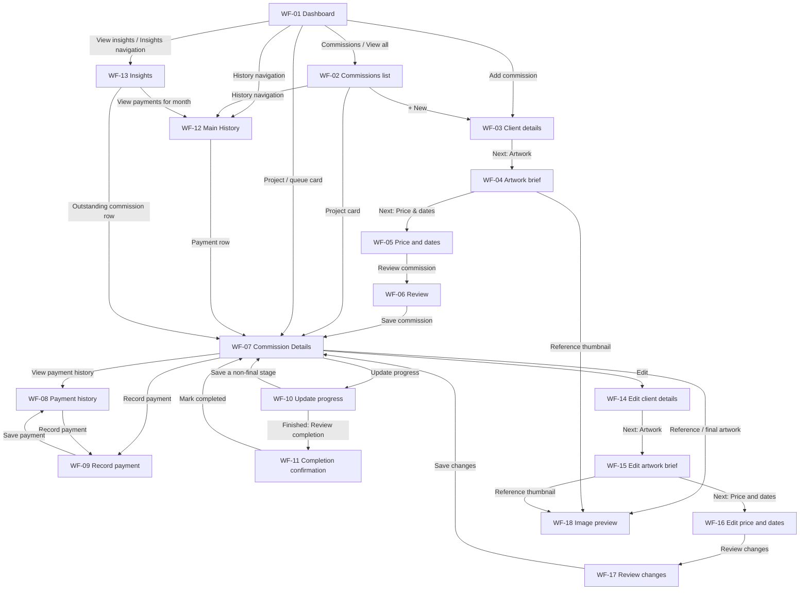

Saving a new commission opens **WF-07Q, Queued**. Starting it later changes the same record to **WF-07A, In progress**. Paying its balance changes its payment state; it does not complete the artwork.

## WF-01 — Home / Dashboard

**Visual:** one phone. **Enter:** launch the app or tap Home. **Scroll:** the dashboard can scroll vertically as its previews grow; bottom navigation remains available. The current drawing shows one viewport.

Read top to bottom: header/date → monthly received earnings → workload counts → current projects → simple checklist → next queued project → Add commission → main navigation.

| Click / action | Destination or result |
| --- | --- |
| Add commission | WF-03, Client details |
| Current work count / View all | WF-02A, Current filter |
| In queue count | WF-02B, Queued filter |
| Current project or next-in-queue card | WF-07 for that project |
| Checklist title | WF-07 for its related project |
| Checklist checkbox | Change only that item's completion; stay on this page |
| All tasks / unfinished-task count | P-07, simple global checklist list; not drawn yet |
| View insights / Insights navigation | WF-13, Insights; Home shortcut carries the selected month |
| Commissions navigation | WF-02, normally Current |
| History navigation | WF-12, main transaction History |

Task-specific dates and the Send color preview action are removed. Commission deadlines and payment received dates remain.

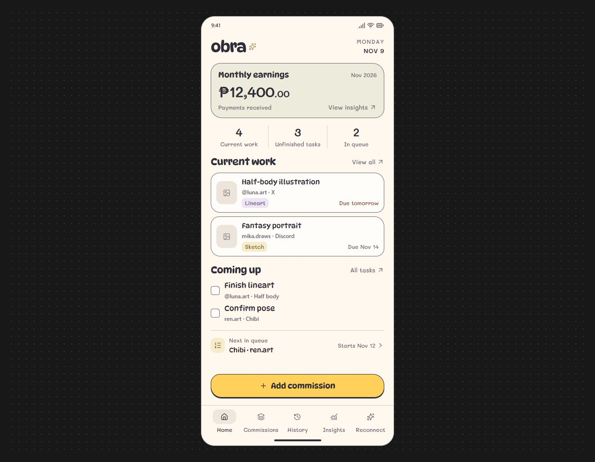

## WF-02 — Commissions list

**Visual:** four phones showing one page's filters/states. **Enter:** Commissions navigation or a dashboard list shortcut. **Scroll:** the list scrolls vertically; New and the main navigation remain reachable. Filter selection changes the list, not the page identity.

| Board position | Reference | What it represents | What a card opens |
| --- | --- | --- | --- |
| Top left | WF-02A | Current: artwork In progress | WF-07A, current record |
| Top right | WF-02B | Queued: accepted but not started | WF-07Q, queued record |
| Bottom left | WF-02C | Completed: previous/finished artwork, even if money is owed | WF-07C, completed record |
| Bottom right | WF-02D | New-artist empty state | Add commission opens WF-03 |

**+ New** also opens WF-03. Search is proposed to match client/project within the selected filter. Returning from a record should restore the filter, query, and list position.

**Commissions stores artwork records; main History lists payment transactions.** One artwork with an initial deposit and a later balance payment is one commission card and two History entries. Previous artwork belongs in Completed, rather than a duplicate archive under History.

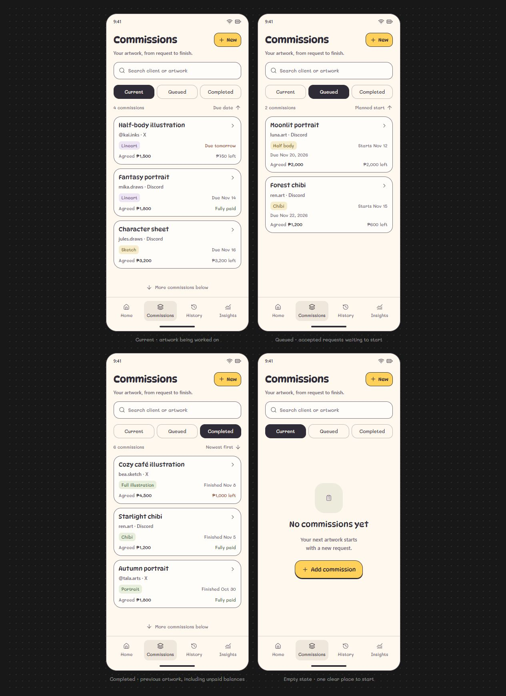

## WF-03 — Add commission, Step 1: Client details

**Visual position:** top left of the intake board below. **Enter:** Add commission or + New. **Type:** separate form step. **Scroll:** usually fits; allow vertical scrolling when the keyboard or accessibility text sizing needs room.

Show platform (X/Discord), username, and optional display name.

- **Next: Artwork** checks the platform/username and opens WF-04 with the draft retained.
- **Back or Close** returns to the entry page if untouched; unsaved edits use the pending Keep editing / Discard dialog.
- Selecting X/Discord changes the contact label only; it does not sign in to a platform.

## WF-04 — Add commission, Step 2: Artwork brief

**Visual position:** top right of the intake board. **Enter:** WF-03 → Next: Artwork. **Type:** separate form step. **Scroll:** the form may scroll for longer instructions or more images; do not shrink text to fit.

Show project title, Full body/Half body/Chibi/Portrait selection, genre/style tags, pose/details, and reference thumbnails.

- **Add image** opens an Android image picker, then returns here. The picker itself has not been drawn.
- A thumbnail opens WF-18, the larger image viewer; Back preserves the intake draft.
- **Next: Price & dates** checks required title/type and opens WF-05 with the draft retained.
- **Back** returns to WF-03. Tag/type selection stays on this step.

## WF-05 — Add commission, Step 3: Price & dates

**Visual position:** bottom left of the intake board. **Enter:** WF-04 → Next: Price & dates. **Type:** separate form step. **Scroll:** especially needed if Record initial payment is expanded or the keyboard is shown.

Show package/add-on quote, agreed total, commission date, due date, optional planned start, and the optional initial-payment control.

- **Calendar icon** opens a date picker dialog and returns here; it is not a new wizard step.
- **Record initial payment** reveals amount, received date, method, and optional note on this same step. Only the collapsed/off state has been drawn so far.
- **Review commission** checks the amount/date information and opens WF-06.
- **Back** returns to WF-04. Next/Review has not saved a commission or payment yet.

## WF-06 — Add commission, Step 4: Review

**Visual position:** bottom right of the intake board. **Enter:** WF-05 → Review commission. **Type:** separate form step. **Scroll:** long summaries scroll; Save remains reachable.

Show client, artwork, schedule, and price/payment groups, each with an Edit link.

| Click | Destination |
| --- | --- |
| Client → Edit | WF-03 with the draft values |
| Artwork → Edit | WF-04 with the draft values |
| Schedule / Price & payment → Edit | WF-05 with the draft values |
| Back | WF-05 |
| Save commission | Validate and save once, then open WF-07Q, Queued |

Save includes any valid initial payment already received. It does not start the artwork or invent a payment for an unpaid quote. Failure keeps the review/draft intact. Detailed validation rules remain in the intake reference below.

**Intake board reading order: top left → top right → bottom left → bottom right.** These are four steps with Next/Back actions, not four scroll positions of one long form.

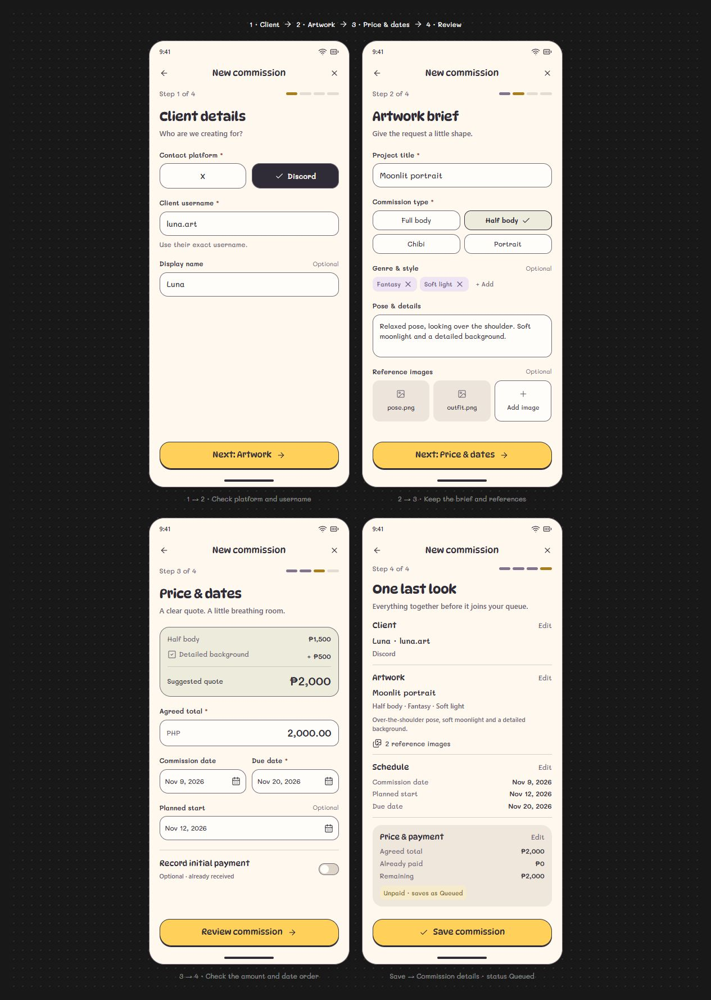

## WF-07 — Commission Details

**Enter:** a project card, a related-commission link, or WF-06 → Save commission. **Type:** one record page with lifecycle variants. **Scroll:** yes; this is the main long/scrolling record.

| Board position | Reference | What it represents | How to get there |
| --- | --- | --- | --- |
| Top left | WF-07A | In-progress record, first viewport: references, brief, creative stages | Open a Current card, or start a queued commission |
| Top right | WF-07B | Lower portion of that exact same record: checklist, dates, payments | Scroll down from WF-07A; no Next button |
| Bottom left | WF-07Q | Queued record, work not started | WF-06 → Save commission, or open a Queued card |
| Bottom right | WF-07C | Completed record, with final artwork/finished date; a balance may remain | Open a Completed card |

WF-07A and WF-07B share the project and record. The two-phone drawing is a way to show long content without cramming it into one phone. They are not tabs or separate Activities in the wireframe specification.

| Click / action | Destination or result |
| --- | --- |
| Record payment | WF-09 |
| View payment history / Payment history | WF-08 for this commission |
| Update progress | WF-10, stage selection |
| Start commission on WF-07Q | Explicitly start work, then show this record as In progress; any start-confirmation state remains to be drawn |
| Edit | WF-14–WF-17, four prefilled steps that update this same commission |
| Reference / final-artwork image | WF-18 image viewer; Back returns to this record and position |
| Checklist checkbox | Change only that item's completion; remain on the record |
| Checklist label | Display only; no extra task-detail button or deadline |
| More options | Secondary actions such as proposed cancellation; confirmation not drawn yet |
| Back | The originating dashboard/list/history view, preserving context |

Work status and payment status remain independent. Fully paid work can still be In progress; Completed work can still have money outstanding.

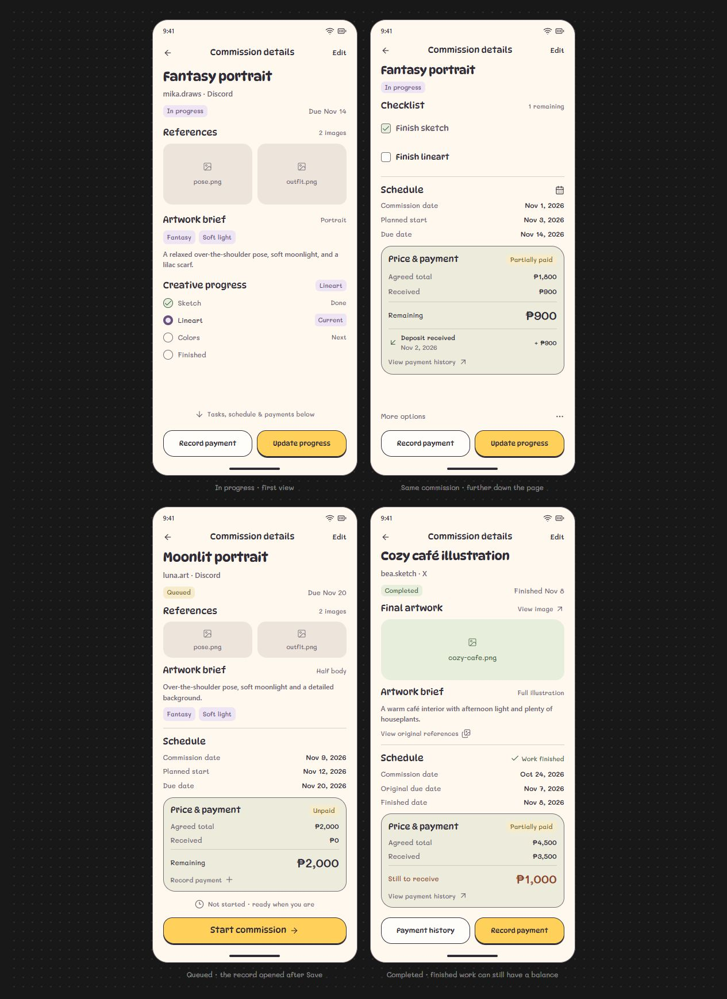

## WF-08 — Payment history for one commission

**Enter:** WF-07 → View payment history / Payment history. **Type:** separate page for one commission's receipts. **Scroll:** yes, when received-payment entries grow.

Show project/client context, agreed price, total received, balance, and the actual received-payment entries with dates, method, purpose, and optional notes. An outstanding balance is not a received payment.

- **WF-08A:** partially paid example, with an initial deposit and an outstanding balance. It is the **right phone below**.
- The **left phone below repeats WF-07B** to show the link's origin. It is not another new page.
- **Record payment** opens WF-09.
- **Back** returns to WF-07 for the same commission and previous position.
- **WF-08B:** this same page after a successful save, including a fully paid state. It appears on the **right of the Record payment board in WF-09**.

This page is distinct from the main History tab: WF-08 shows one commission's money; WF-12 shows transactions across commissions. WF-13 Insights is the separate reporting/graphs page.

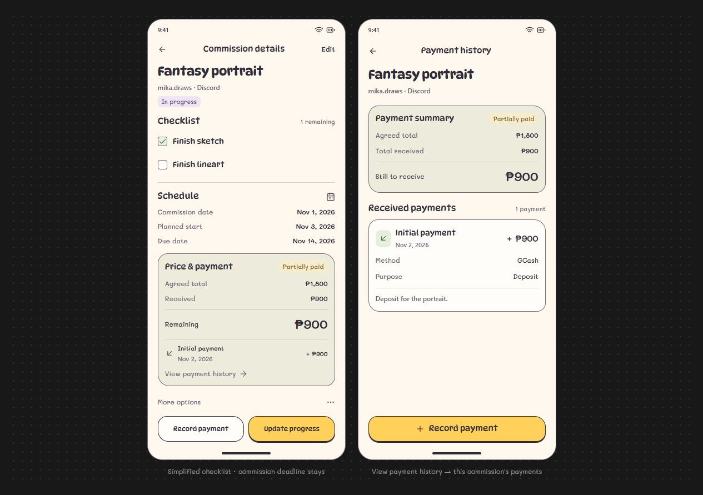

## WF-09 — Record payment

**Visual position:** left phone below. **Enter:** Record payment from WF-07 or WF-08. **Type:** separate short form, not an analytics page. **Scroll:** the form can scroll with the keyboard or longer notes; Save remains reachable.

Show the selected project/client, current balance, amount received, date received, payment method, optional note, and a clearly labeled after-save balance preview.

| Click / action | Destination or result |
| --- | --- |
| Calendar icon | Date picker dialog, returning to this form |
| Payment method | Method chooser, returning to this form |
| Save payment | Check a positive amount within the outstanding balance, valid received date/method; save once and open WF-08 with refreshed totals |
| Back / Close before saving | Return to the originating record/history; unsaved changes use Keep editing / Discard |

**Right phone = WF-08B, the existing Payment history page after Save.** Payment recorded is brief feedback on that page, not a separate confirmation screen. In the example, the new balance payment joins the existing initial deposit, the balance becomes zero, and the work remains In progress.

When the balance is zero, **Back to commission** returns to WF-07. When a partial balance remains, Payment history can continue offering Record payment. A failed save preserves the form and does not update money totals.

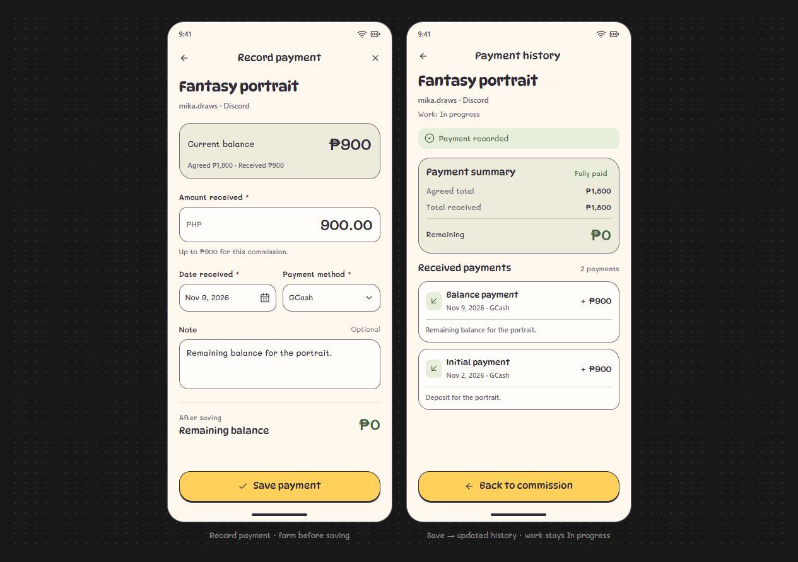

## WF-10 — Update progress

**Enter:** WF-07 → Update progress on an In-progress commission. **Type:** separate page, with no main bottom navigation. **Scroll:** the stage list can scroll on shorter displays or with enlarged text; the primary action remains reachable.

The new board contains two selection states of this page, a confirmation, and the resulting existing record:

| Board position | Reference | What it represents | Next action |
| --- | --- | --- | --- |
| Top left | WF-10A | Colors selected while the saved stage is Lineart | Save progress → WF-07 with Colors saved; lifecycle remains In progress |
| Top right | WF-10B | Alternative selection: Finished, still unsaved | Review completion → WF-11 |
| Bottom left | WF-11 | Review completion and choose actual finished date | Mark completed → WF-07C |
| Bottom right | WF-07C | Existing Commission Details page after confirmation | Payment history → WF-08; Record payment → WF-09 |

**The top two phones are alternatives, not successive pages.** Selecting a radio row changes only the draft choice. Non-final stages use **Save progress**; selecting Finished changes that action to **Review completion**. The commission's status changes only after the corresponding save/confirmation succeeds.

Back/Close returns to the originating record; changed choices use the shared Keep editing / Discard pattern, whose dialog is still undrawn. Opening this page preselects the saved stage; disable Save progress until the choice changes. Stage changes do not check checklist items or add payments.

## WF-11 — Completion confirmation

**Enter:** WF-10 → Finished → Review completion. **Type:** short full-page review, rather than a bottom sheet. **Scroll:** yes if needed; Mark completed and Keep working remain reachable.

Show project/client, original deadline, actual finished date, and current payment totals. Finished date defaults to today and can be changed using the calendar. The proposed date checks allow a past finish date from the commission date through today; preserve the original deadline, including when work finishes late.

| Click / action | Destination or result |
| --- | --- |
| Finished date / calendar | Date picker; return to this review |
| Mark completed | Save finished date and Completed lifecycle once; set creative stage Finished; return to the same record as WF-07C |
| Keep working / Back | Return to WF-10 with Finished still selected for review; nothing committed |
| Close | Return to the originating WF-07 without completing; use shared discard handling if changes would be lost |

The result shows brief **Commission completed** feedback on WF-07; this is not another success page. The record moves from Current to Commissions → Completed. Existing money, references, notes, and checklist states are retained; completion does not automatically check unfinished items. A final-artwork attachment is not required by this draft; its eventual role remains open.

**Example:** Fantasy portrait finishes Nov 9, 2026, ahead of its Nov 14 deadline. Agreed ₱1,800, received ₱900, and remaining ₱900 stay the same after confirmation. This board follows the partially paid snapshot, independently of the Fully paid example on the Record payment board.

Completion currently means the artist marks the artwork finished. Whether delivery or client acceptance should be required is still a review question. Save failures retain the form without showing a completed record. See the [progress/completion draft](docs/update-progress.md) for the proposed rules.

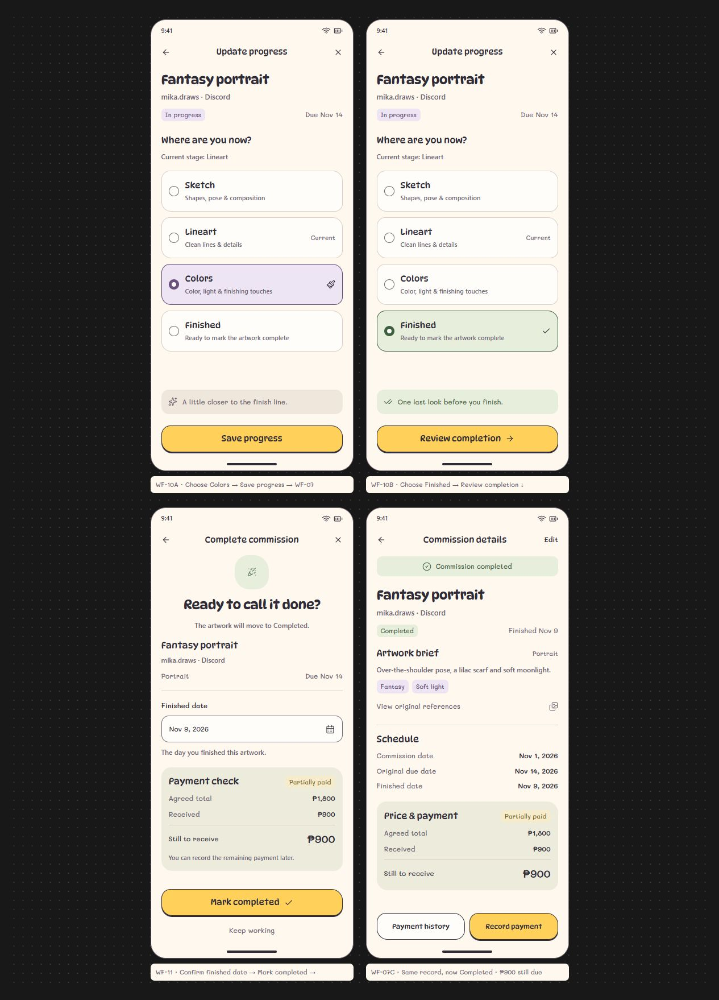

## WF-12 — Main transaction History

**Enter:** History in main navigation. **Type:** a main page, distinct from WF-08 commission-specific Payment history. **Scroll:** the timeline scrolls vertically; main navigation remains reachable. The drawing shows one viewport rather than every receipt compressed into one phone.

| Board position | Reference | What it represents |
| --- | --- | --- |
| Left | WF-12A | November 2026: five payments totaling ₱4,450; newest four visible, one earlier receipt below |
| Right | WF-12B | Same page with January 2026 selected: zero payments and Choose another month |

Read top to bottom: History → month/year selector → received total for that month → receipt count/newest-first label → received-date groups → payment rows → main navigation with History selected.

Each row shows artwork, received amount, username/platform, payment purpose, and method. A deposit and a later balance payment remain two entries even when linked to the same artwork. Quotes and outstanding balances do not appear as receipts; commission due dates remain in WF-07.

| Click / action | Destination or result |
| --- | --- |
| Month selector / Choose another month | Month/year chooser, then update this same page; chooser is not drawn yet |
| Payment row / chevron | WF-07 for that commission; Back restores this month and timeline position |
| Home / Commissions navigation | WF-01 / WF-02 |
| History navigation | Remain on WF-12, preserving context |
| Insights navigation | WF-13 |

First entry defaults to the current month. Summary/count cover the full selected month, including offscreen receipts. For the mock November, amounts are ₱900 + ₱1,000 + ₱900 + ₱750 + ₱900 = ₱4,450; the final ₱900 initial payment, received Nov 2, is below the viewport. No new payment-details or global payment-entry page is added. Use WF-07 → WF-08 to see notes and all receipts for one artwork, or WF-09 to record another payment.

The two phones are states, not a Next/Back sequence. This is a new static draft for review. See [the main History plan](docs/main-history.md) for routes, sample receipts, and remaining states.

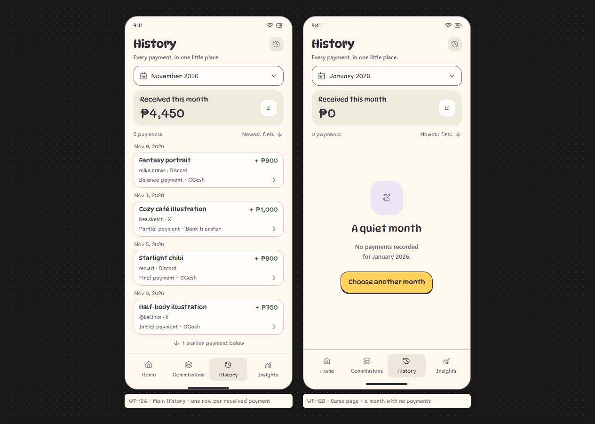

## WF-13 — Insights

**Enter:** Insights in main navigation, or WF-01 → View insights with the dashboard month carried over. **Type:** one report page. **Scroll:** yes; these two phones show its first and lower views, not two destinations. Main navigation remains reachable.

| Board position | Reference | What it represents |
| --- | --- | --- |
| Left | WF-13A | Overview: monthly received earnings/count, all-time received total, current outstanding balance, six-month earnings chart |
| Right | WF-13B | Further down the same page: selected-month receipts by commission type, then current outstanding commissions |

Month selection updates monthly earnings/count, the trend's six-month window ending in that month, and the type breakdown. **Total earnings remains all-time received as of today; Still to receive remains current balances as of today.** Keep those scopes visible, including when reviewing a past month.

| Click / action | Destination or result |
| --- | --- |
| Month/year selector | Shared period chooser; not drawn yet; update this same page when applied |
| View payments | WF-12 with the same reporting month selected |
| See balances | Scroll directly to the lower Still to receive section, WF-13B; no new page |
| Outstanding commission row | WF-07 for that record; Back restores Insights selection/position |
| Home / Commissions / History navigation | WF-01 / WF-02 / WF-12; ordinary History navigation restores its own prior month |
| Insights navigation | Stay here and preserve context |
| Chart bars / type rows / Total earnings | Display only in this draft; no extra edit or detail page |

The fictional Nov 9 snapshot matches History's **₱4,450 from five receipts**. Monthly trend June–November: ₱1,800, ₱3,000, ₱4,200, ₱5,350, ₱5,200, ₱4,450; these sum to **₱24,000 all-time** because this example has no earlier receipts. November is labeled partial, through Nov 9. The type breakdown sums to ₱4,450; **₱7,550 currently outstanding** spans five artworks, including a completed commission. Owed amounts are excluded from received earnings.

This is a new static draft for review. See [the Insights plan](docs/insights.md) for definitions, arithmetic, routes, and undrawn empty/error states. The lower view is reached by scrolling, not Next.

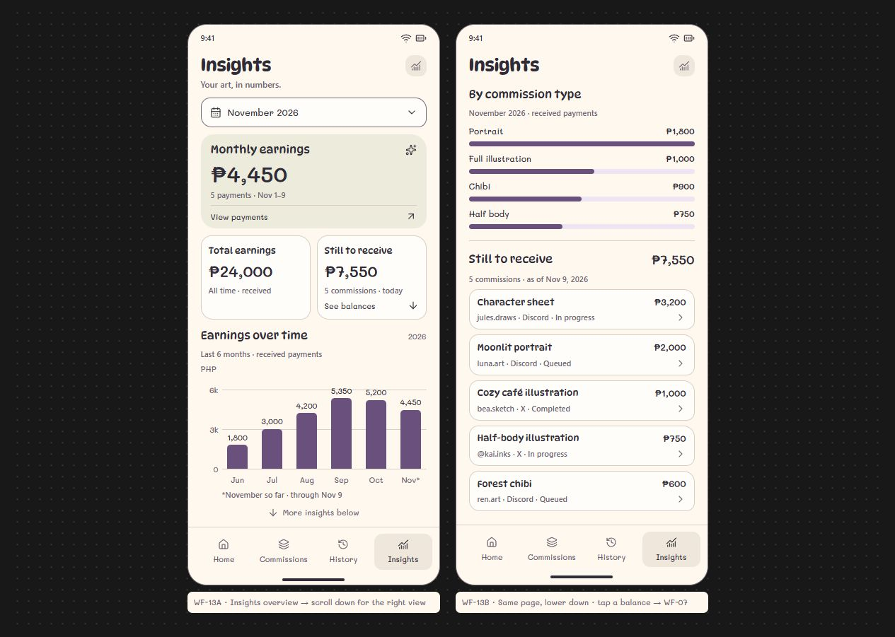

## WF-14 — Edit commission: Client details

**Enter:** WF-07 → Edit. **Position:** top left of the edit board below. **Type:** separate prefilled form step, Step 1 of 4. **Scroll:** with keyboard, longer content, or larger text; Next stays reachable. No main bottom navigation.

Show the existing platform, username, optional display name, and read-only work context. In the example: Discord, mika.draws, Mika, Fantasy portrait, In progress / Lineart. **Next: Artwork** checks client fields and opens WF-15; it does not save edits yet.

## WF-15 — Edit commission: Artwork brief

**Enter:** WF-14 → Next: Artwork. **Position:** top right of the board. **Type:** separate prefilled form step, Step 2 of 4. **Scroll:** brief and reference content can grow.

Show saved title, type, tags, pose/details, and references. Add image uses the device picker; thumbnail opens WF-18. A remove cross stages reference removal in the draft rather than immediately deleting saved material. **Next: Price & dates** opens WF-16 with the draft preserved. Changing type does not silently replace the agreed price or reset progress.

## WF-16 — Edit commission: Price & dates

**Enter:** WF-15 → Next: Price & dates. **Position:** bottom left. **Type:** separate edit step, Step 3 of 4. **Scroll:** as needed with keyboard/validation.

Show agreed total, read-only Already received, remaining balance preview, commission date, optional planned start, and due date. Omit intake's initial-payment toggle; received payments are maintained through the separate payment flows. The example keeps ₱1,800 agreed and ₱900 received while changing the due date **Nov 14 → Nov 16, 2026**.

**Review changes** checks the draft and opens WF-17. A proposed minimum for an edited total is the amount already received; the below-received error/refund/correction flow remains undrawn. Price edits can change the balance without adding earnings. Editing dates does not change actual work status or completion dates.

## WF-17 — Edit commission: Review changes

**Enter:** WF-16 → Review changes. **Position:** bottom right. **Type:** separate review step, Step 4 of 4. **Scroll:** the review can grow for longer content/multiple changes.

Show a before/after summary followed by Client, Artwork, Schedule, and Price & payment groups. The example has one change, due date Nov 14 → Nov 16; work remains In progress / Lineart and payment remains Partially paid.

| Click / action | Destination or result |
| --- | --- |
| Client → Edit | WF-14 with the current edit draft |
| Artwork → Edit | WF-15 with the current edit draft |
| Schedule / Price & payment → Edit | WF-16; existing received payments stay read-only |
| Save changes | Validate and update the same record once; return to WF-07 with Commission updated feedback |
| Back on Steps 2–4 | Previous edit step; retain draft values |
| Back on Step 1 / Close on any step | Return to the originating WF-07; changed values use Keep editing / Discard |

Saving edits does not create a new artwork, return work to Queued, reset progress/checklists, or record another payment. Failed saves preserve the draft. The saved result is a state of the existing WF-07, not another success screen. Disable Save changes when no effective edits remain. Discard/reference-removal/error and other lifecycle variants are still undrawn.

**Read the board top left → top right → bottom left → bottom right.** These are four steps connected by buttons, unlike the scroll continuations shown for Details and Insights. See [the edit plan](docs/edit-commission.md) for draft handling and proposed validation rules. This is a new static proposal for review.

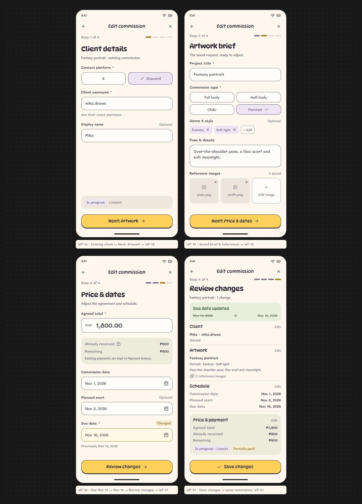

## WF-18 — Image viewer

**Enter:** reference/final-artwork thumbnail in WF-07, attached-reference thumbnail in WF-04 or WF-15, or View original references on a completed record. **Type:** one dedicated preview page. **Scroll:** normal chrome fits a viewport; zoom/pan stays in the image area. Accommodate larger text/shorter screens without cutting off Back or viewing controls. No main navigation.

| Board position | Reference | What it represents |
| --- | --- | --- |
| Left | WF-18A | pose.png, first of two references for Fantasy portrait |
| Right | WF-18B | cozy-cafe.png, one final-artwork image for Cozy café illustration |

These are collection variants of the same page. Earlier boards show the small thumbnails; this is their larger destination. Image content remains a placeholder in these drawings.

| Click / action | Destination or result |
| --- | --- |
| Header Back / Android Back | Return to the exact originating form/record with its draft and scroll position intact |
| Next / Previous | Select another image from this collection on WF-18; update count/filename and fit the new image |
| Thumbnail | Select that image on this same page |
| Plus / minus / pinch | Adjust magnification; drag an enlarged image to pan |
| Fit image | Reset zoom/pan and show the complete image at its original aspect ratio |

Previous is unavailable at the first image; Next is unavailable at the last. A single-image collection hides its thumbnail strip, count, and pager. Previewing does not attach, save, delete, complete, or pay for anything. Back from a form preview preserves its unsaved draft without a discard prompt. See [the image viewer draft](docs/image-viewer.md) for detailed behavior and undrawn zoom/error states.

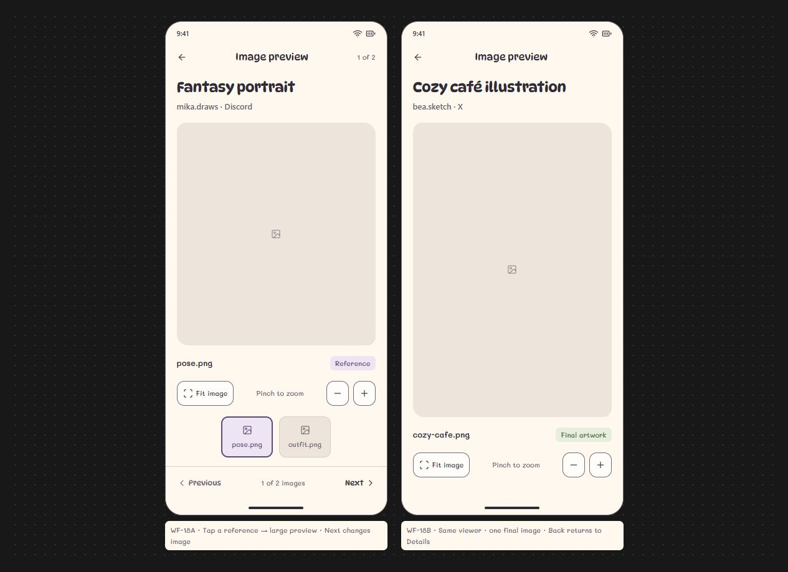

## Planned next wireframes — not drawn yet

These entries explain destinations already mentioned by buttons. They are not hidden existing designs.

| Planned number | Wireframe | Entry button / context | Expected type |
| --- | --- | --- | --- |
| P-07 | All checklist items | WF-01 → All tasks / unfinished-task count | Simple scrolling checklist across commissions, with parent-commission links; no task dates or task-editor pages |

Additional **states/dialogs**, rather than automatically separate main pages, still need drawings: WF-05 initial-payment fields expanded; form validation; no search matches; empty categories; discard changes; any start/cancel confirmation; save failure; and date/method pickers if a custom layout is needed. Cancelled-record list access remains a later proposal.

**Next suggested design task: P-07 All checklist items.** The four main sections, edit flow, and image viewer now have static drafts; continue reviewing them alongside supporting states.

## Shared design and detailed behavior reference

The reference sections below preserve the font, color, spacing, and field rules behind the numbered pages above. Their lettered headings are not additional wireframe numbers.

## A. Phone layout

| Item | Planning reference |
| --- | --- |
| Device | Android Studio Medium Phone, portrait |
| Logical canvas | Approximately 411 x 914 dp, including system areas |
| Physical reference | 1080 x 2400 pixels at the observed 420 dpi configuration |
| Side margins | 20 dp; allow 16 dp where a denser form needs room |
| Spacing | 8 dp between closely related items; 16 dp within sections; 24 dp between major sections |
| Cards | Soft, slightly irregular corners around 20-24 dp; light outlines |
| Form fields | Consistent rounded corners around 14-16 dp |
| Primary actions | Rounded, visibly labeled, about 48-52 dp tall |
| Touch areas | Plan for at least 48 x 48 dp around actionable controls |
| Long content | Scroll the content; keep navigation and important actions reachable |

Use dp for layout and sp for text in the future Android implementation. Show status/navigation areas in the wireframes without assuming that all 914 dp is available for app content. Account for bottom system insets and the keyboard in later detailed layouts.

## B. Typography

### Primary font: DynaPuff

Use DynaPuff for the recognizable, playful parts of the interface:

| Element | Example | Proposed weight and size |
| --- | --- | --- |
| OBRA name | obra | SemiBold, 32-36 sp |
| Screen title | Commission details | SemiBold, 24-28 sp |
| Section title | Current work, Coming up | Medium/SemiBold, 20-22 sp |
| Summary label | Monthly earnings | Medium, 16-18 sp |
| Task title | Finish lineart, Confirm reference pose | Medium, 16 sp |
| Commission card title | Half-body illustration | Medium, 16 sp |
| Main action | Add commission, Save commission | Medium/SemiBold, 16-18 sp |
| Step heading | Client details, Artwork brief | Medium/SemiBold, 20-24 sp |

Use the font's normal/static appearance for these wireframes. Keep longer DynaPuff titles on multiple lines when necessary rather than squeezing them into narrow spaces.

### Supporting font: Mali — accepted joyful pairing

The owner requested a joyful supporting font for **Due tomorrow**, **Due Nov 14**, **All tasks**, **Nov 10**, and all similarly styled text, then accepted the dashboard using **Mali** alongside DynaPuff. Continue that pairing in the Add commission screens.

Use Mali consistently for:

- Client usernames and platform names.
- Project descriptions, pose instructions, and revision notes.
- Form labels, entered text, helper messages, and validation errors.
- Dates, payment amounts, balances, and graph labels.
- Status chips, step counts, and bottom-navigation labels.

Proposed sizes are 14-16 sp for ordinary details, 16 sp for editable text, and 12-13 sp for short secondary captions. Use around 28-32 sp for the main earnings amount and 24-28 sp for workload counts. Keep financial figures in Mali, even when the label above them uses DynaPuff.

Use Medium weight for small dates, links, and supporting labels, and SemiBold for prominent financial figures and counts. The dashboard uses supporting labels around 12-13 sp so the handwritten details remain legible.

**DynaPuff and Mali are the accepted pairing.** Individual sizes, spacing, and form layouts remain open to refinement.

## C. Proposed color scheme

The palette follows the warm, simple direction of the [Guhit reference](https://app.guhit.app/). The exact values below are proposed for OBRA.

| Role | Color | Use |
| --- | --- | --- |
| Page background | Warm cream `#FFF8EF` | Main screen background |
| Card/field surface | Soft white `#FFFDF9` | Commission cards, input areas, dialogs |
| Primary text | Deep charcoal `#302C37` | Titles, body text, values, button labels |
| Secondary text | Muted plum-gray `#6B6270` | Dates, captions, short supporting information |
| Main action | Butter yellow `#FFD15B` | Add commission, Next, Save; pair with charcoal text |
| Earnings summary | Pale sage `#ECEBDC` | Monthly earnings panel |
| Selected navigation | Warm beige `#F0E7DC` | Active bottom-navigation item |
| Control outline | Muted charcoal `#746A76` | Visible boundaries for inputs and outlined controls |
| Decorative divider | Light beige `#D8CEC4` | Noninteractive separators |
| Image placeholder | Warm gray `#EDE5DC` | Reference/artwork placeholders |
| Creative progress | Lavender `#EDE4F4` + text `#5D4975` | Lineart/progress chips |
| Sketch/queued accent | Soft gold `#F6EBCB` + text `#725A20` | Sketch or waiting-stage chips |
| Completed/paid accent | Pale green `#E7EEDB` + text `#3E6040` | Completed or fully paid labels |
| Urgent deadline | Pale peach `#FBE6D7` + text `#8E452A` | Due-soon and overdue notices |
| Destructive action | Pale rose `#FAE1DE` + text `#A23D38` | Cancel/delete confirmation actions |
| Chart series | Plum `#6A507D` | Initial earnings graph series in Insights |

Use dark text on yellow buttons. Keep destructive controls visually separate from the normal primary action. Pair status colors with words such as **Overdue**, **Partially paid**, or **Completed**; color alone must not carry the meaning.

The earnings panel's sage fill is decorative and does not mean that all commissions are paid. Graph axes, dates, and values use the normal text colors. Additional graph series should be chosen only when their meanings are defined.

Draw this light palette first. A dark theme has not been requested or specified.

## D. Dashboard: detailed action reference

### Top-to-bottom layout

1. **Header:** OBRA name, short studio context, current date.
2. **Monthly earnings:** DynaPuff label, received-income amount, selected month.
3. **Quick counts:** current work, unfinished tasks, queued commissions.
4. **Current work:** two commission previews with image placeholders, title, username/platform, stage, and deadline.
5. **Coming up:** a simple checklist preview with DynaPuff task titles, related client, and completion state; task-specific deadlines are removed.
6. **Next in queue:** next accepted commission and planned start, when known.
7. **Add commission:** one prominent yellow action.
8. **Bottom navigation:** Home, Commissions, History, Insights.

The dashboard's data summaries do not require every entire card to be a button. Use a clear **View insights** label on the earnings panel and explicitly labeled **View all** actions on list sections.

### What tapping each part should do

| Starting control | Planned next view or result |
| --- | --- |
| View insights on Monthly earnings | Open WF-13 Insights with the same month selected |
| Current work count | Open WF-02A, the Current filter (In progress records) |
| Unfinished task count / All tasks | Open the unfinished task list across commissions |
| In queue count | Open Commissions filtered to Queued |
| Current work → View all | Open WF-02A, the Current filter |
| Commission card | Open that commission's details |
| Dashboard task title such as Finish lineart | Open the related commission; no separate task-detail page is needed |
| Task checkbox | Mark only that task complete; update task counts in the eventual app |
| Next in queue preview | Open that queued commission's details; do not start it automatically |
| Add commission | Open Step 1: Client details |
| Home | Return to the dashboard |
| Commissions | Open WF-02, initially showing the Current filter; other status filters remain available |
| History | Open WF-12, individual payment transactions across commissions; previous artwork is under Commissions → Completed |
| Insights | Open WF-13 earnings summaries and graphs |

On the dashboard, a task title leads to its commission while its checkbox changes only the checklist item's completion state. Completing **Finish lineart** must not automatically mark the entire commission completed or record any payment. The checklist has no per-task due dates. The Send color preview row/action and additional task-detail/custom-entry controls are omitted from the simplified draft.

## E. Add commission: validation and draft behavior

Use the accepted four-step wireframe direction so a long form can be reviewed in manageable groups. Show **Step 1 of 4** and a clear step heading. Draw the four screens together on the static board.

See [the Add commission wireframe plan](docs/add-commission.md) for the current four-screen draft and its follow-up states. These screens keep the New commission header and Back/Close controls; main bottom navigation is omitted during entry.

### Step 1 — Client details

**Show:** contact platform (X or Discord), username, optional display name.

**Action:** **Next: Artwork**.

1. Check that a platform and a nonblank username are provided.
2. If something is missing, stay on Step 1 and show a Mali helper/error message under the relevant field.
3. If valid, keep the entered values in the draft and move to Step 2.

This step does not sign in to X/Discord, contact the client, or create a saved commission.

### Step 2 — Artwork brief

**Show:** package/type, title, genre/style tags, requested pose, brief/notes, reference-image area.

**Actions:** **Back** and **Next: Price & dates**.

1. Choose Full body, Half body, Chibi, Portrait, or another configured package.
2. Add the brief and attach any supplied references.
3. Tapping **Add image** should eventually open the Android image picker; selecting an image returns here with a thumbnail. Cancelling the picker leaves the draft unchanged.
4. Next checks that a commission type and a short project title are present.
5. If valid, keep the draft and move to Step 3. If invalid, remain here with field-specific messages.

For this draft, reference images and tags are optional so a request can be logged before the client supplies everything. Required fields can be revised during review.

### Step 3 — Price and dates

**Show:** base package price, proposed add-ons if retained, agreed total, commission date, optional planned start, due date, and optional initial-payment fields.

**Actions:** **Back** and **Review commission**.

1. Selecting a package supplies a starting quote; any approved add-on controls update the draft quote.
2. Record the agreed total. The rule for manually overriding a calculated quote still needs agreement.
3. The commission date defaults to today and remains editable. Calendar controls open a date picker and return the selected date here.
4. Enter a due date. If a start date is provided, it should fall between the commission date and the due date.
5. An optional initial payment has its own amount, received date, and method. Its received date must not be replaced by the commission's due date.
6. **Review commission** checks a positive agreed total and a valid date sequence. When an initial payment is included, it also checks that its amount is positive, does not exceed the agreed total, and has a received date.
7. Missing or invalid information keeps the user on this step. Valid information opens Step 4.

Selecting a payment method records a label; it does not open a payment service or transfer money. Until final save, values remain draft information and do not affect earnings or queue counts.

### Step 4 — Review commission

**Show:** grouped summaries of the client, artwork request, references, agreed quote, dates, and any initial payment. Provide an **Edit** action for each group.

**Actions:** **Back** and **Save commission**.

1. **Back** returns to Step 3 with the draft intact.
2. A group's **Edit** action opens its corresponding step; following Next returns through the remaining steps to Review.
3. **Save commission** rechecks the complete draft.
4. The planned implementation saves the commission and its attachments/initial payment together, then opens that commission's details.
5. The initial lifecycle status is **Queued**. **Start commission** is a separate action.
6. A brief **Commission added** message confirms success. Returning to Home should show the updated queue and any received-income amount.

Only final Save creates the commission. If save fails, remain on Review with the entered information preserved and a retry option. Prevent repeated taps from creating duplicate records in the eventual implementation.

### Back, close, and interrupted entry

- **Back within Steps 2-4:** go to the previous step and preserve the draft.
- **Back from Step 1 or Close:** if the draft has edits, show **Discard this commission?** with **Keep editing** and **Discard**.
- **Keep editing:** return to the same step and values.
- **Discard:** return to the screen that opened the form; create no commission or payment.
- Saving drafts across app restarts has not been requested; it remains a separate future decision.

## F. Commission Details: detailed action reference

See [the Commission Details wireframe plan](docs/commission-details.md) for the current board. It shows the first and lower portions of one in-progress record, plus Queued and Completed states. The queued record continues the intake example; the completed record demonstrates a remaining balance.

| Control | Planned sequence and result |
| --- | --- |
| Back | Return to the originating list, dashboard, or history view with its filter preserved |
| Edit | WF-14–WF-17, four prefilled groups; Save changes returns to the same record |
| Save changes | Save the edited commission and return to its details; retain existing payment records |
| Start commission | Change a queued record to In progress after an explicit start action; show its initial creative stage |
| Update progress | Open WF-10 stage choices; Save progress applies a non-final stage and returns to the same details record |
| Record payment | Open the [payment-entry form](docs/record-payment.md) showing context, amount/date/method/note, and after-save balance; Save returns to updated commission payment history |
| Reference thumbnail | Open WF-18 full image preview; Back returns to the same commission |
| Checklist label | Display a task name; no extra task-detail button or date |
| Checklist checkbox | Complete only that task and refresh the unfinished-task count |
| Finish/complete | WF-10 Finished → Review completion → WF-11; confirm actual finished date and mark the work Completed without altering payments |
| Cancel commission (planned) | Review a cancellation confirmation; confirmed cancellation changes lifecycle status while retaining history; confirmation not drawn yet |

Completing a commission must not mark it paid automatically. If money is still owed, show the remaining balance on the completed record. Whether Completed means artwork finished, final files sent, or client acceptance still needs a project decision.

Editing an agreed price must not silently erase payments. The [edit draft](docs/edit-commission.md) proposes blocking a total below already received money; the error presentation, refund/correction flow, and historical pricing/date restrictions remain open. A permanent Delete action is deferred until historical retention rules are agreed.

**View payment history** opens [a dedicated payment list](docs/payment-history.md) for the selected commission. Show its initial deposit and later received payments with amounts, received dates, method, optional notes, and remaining balance. Entries display their details directly; they do not need another receipt-details screen. The commission's deadline and payment received dates stay; only per-task deadlines are removed.

The [Record payment draft](docs/record-payment.md) has a single Save payment action. Its example clears the remaining balance and returns to Fully paid history while the artwork stays In progress. Validate a positive amount within the outstanding balance, a received date, and a method. The date defaults to today and can be changed; notes are optional. Back/Close use Keep editing / Discard if the form has unsaved changes.

## G. Main section definitions

### Commissions and History

- **Commissions:** artwork records filtered by Current, Queued, or Completed. See [the list wireframe](docs/commissions-list.md).
- **Completed:** previous/finished artwork, including commissions with a balance still owed.
- **History:** individual deposits and later payments across commissions. One artwork may have several entries here.

- **Payment entry:** show amount, received date, method, note, and related commission directly, without requiring a separate receipt-details screen.
- **View commission:** open the parent commission, even if completed or cancelled.
- **Previous commission row:** open its complete record, including due date, actual finish date, and amounts received.
- **Month selector:** update WF-12 receipts, count, and received total by payment received date, without changing stored records; no work-status filter in this draft.

The current recommendation separates payment transactions in History from previous artwork in Commissions → Completed. The [main History draft](docs/main-history.md) now shows WF-12 populated and empty-month states, alongside the existing Commissions list and commission-specific payment-history drafts.

### Insights

- **Month selector:** choose a reporting month and update monthly totals/count, type breakdown, and six-month trend ending in that month.
- **Total earnings:** show received payments over the stated all-time reporting period.
- **Monthly earnings:** show payments received in the selected month.
- **Outstanding balances → See balances:** scroll to the current balances on this page, including completed work that is still owed money; individual rows open WF-07.
- **View payments:** open WF-12 with the selected reporting month.
- **Graph period point/bar:** directly labeled amounts; display only in this static draft.

Changing a report filter never edits commissions or payments. All-time earnings and current balances keep their stated current scopes when a past reporting month is selected. See [the Insights draft](docs/insights.md); detailed graphs belong here rather than filling the dashboard.

## H. Maintaining the static board

Keep the numbered catalogue and saved previews in sync when a design changes. Preserve the distinction between a new page, a same-page state, and a scroll continuation. Do not add an extra page number for a payment success banner, selected filter, or checklist toggle.

The existing boards cover the standard dashboard, four-step intake, list filters/empty list, current/queued/completed detail variants, commission payment history, payment entry with its saved result, progress/completion, main History with populated/empty months, Insights with a lower scroll view, the four-step edit flow, and image viewer variants. Additional empty/error/urgent/dialog states are listed as pending above rather than presented as completed drawings.

Use DynaPuff for **Monthly earnings**, **Finish lineart**, and the other specified titles in every state. Place notes such as **Next: Artwork → Step 2** outside the phone frames when a control's destination needs explanation.

The board should communicate the planned behavior through labels, arrows, and separate states. Implementing the clicks or transitions is outside the current wireframe phase.

## Related plans

- [Dashboard](docs/dashboard.md)
- [Commissions list](docs/commissions-list.md)
- [Add commission wireframe](docs/add-commission.md)
- [Edit commission wireframe](docs/edit-commission.md)
- [Image viewer](docs/image-viewer.md)
- [Commission Details wireframe](docs/commission-details.md)
- [Commission payment history](docs/payment-history.md)
- [Main transaction History](docs/main-history.md)
- [Insights](docs/insights.md)
- [Record payment wireframe](docs/record-payment.md)
- [Screen inventory](docs/screens.md)
- [Design direction](docs/design-direction.md)
- [Requirements](docs/requirements.md)
- [Open decisions](docs/decisions.md)
